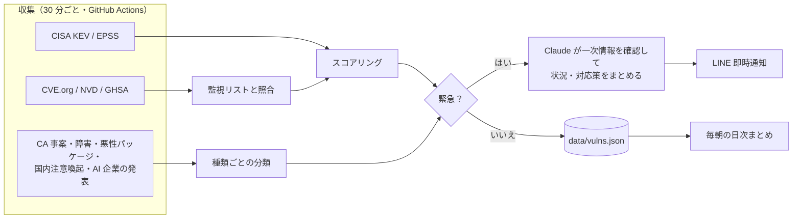

<p align="center">
  
</p>

<h1 align="center">noroshi（狼煙）</h1>

<p align="center">
社会的な影響が大きくなりそうな脆弱性や IT の異変を、いち早く LINE に知らせる監視ボット
</p>

---

## これは何か

PHP や OpenSSL、VPN 機器のように広く使われているソフトウェアに深刻な脆弱性が見つかると、数日のうちに大規模な攻撃や社会問題に発展することがあります。AI を使った攻撃が増えるにつれて、公開から悪用までの時間はさらに短くなっています。

狼煙は、一次情報を定期的（30 分ごと）に集めて「広く使われているか」「深刻か」「実際に悪用されているか」で点数を付け、本当に急ぐべきものだけを LINE に送ります。緊急の案件には、Claude が一次情報を読んでまとめた「状況」と「対応策」が付きます。

脆弱性のほかに、クラウドの大規模障害、人気パッケージの乗っ取り、認証局の鍵侵害、国内の公的な注意喚起、AI 企業のセキュリティ発表、主要製品のサポート終了も見ています。

## 通知の例

即時通知（LINE）:

```
🚨 脆弱性アラート 1件

■ CVE-2026-109619  score 74.3
対象: php
CVSS: 9.2
PHP has various global state that temporarily points into request memory
https://github.com/php/php-src/security/advisories/GHSA-6wmf-4rv5-p3rp
```

続けて届く AI 分析（抜粋）:

```
🤖 CVE-2026-109619

【状況】PHP本体に解放後メモリ使用（UAF）の欠陥があり、認証なしでリモートから
コードを実行される恐れがあります（CVSS 9.2）。修正版は10/21に公開済みです。…
【影響範囲】PHP 8.2.35／8.3.36／8.4.27／8.5.12より前のすべての版。…
【対応策】
1. 今日中に8.2.35／8.3.36／8.4.27／8.5.12以降へ更新してください。…
2. 公式の回避策は未確認です。…
【出典】https://github.com/php/php-src/security/advisories/GHSA-6wmf-4rv5-p3rp
```

クラウド・SaaS の大規模障害は、発生と復旧の両方を知らせます:

```
🚨 狼煙アラート 1件

■ OUT-anthropic-0ns5clsk8p2x  score 90
対象: anthropic
種別: クラウド・SaaS 障害
Anthropic Claude: …
```

```
✅ 復旧: Anthropic Claude: …
```

毎朝 9 時台には、即時通知に届かなかった中〜高の案件を製品ごとにまとめた「日次まとめ」と、サポート終了の予告が届きます。日次まとめの先頭には、Claude がその日の案件一覧から選んだ「今日の要点」（3 行以内）が付きます。

## 監視しているもの

| 種類 | 取得元 | 即時通知 | 日次まとめ |
|---|---|---|---|
| 脆弱性（CVE） | CVE.org、NVD、GitHub Security Advisories、CISA KEV、FIRST EPSS | スコア 70 以上 | スコア 30 以上 |
| 認証局（CA）事案 | Mozilla CA Program（Bugzilla） | 鍵侵害、ルート証明書の信頼取り消し | 誤発行、失効の遅れ |
| クラウド・SaaS 障害 | AWS、Azure、Google Cloud、Cloudflare、GitHub、Slack、Zoom ほか計 13 社の公式ステータスページ | 大規模障害（復旧時も通知） | 軽微な障害 |
| 悪性パッケージ | GitHub のマルウェア勧告 + npm / PyPI のダウンロード数 | 週 1 万 DL 以上のパッケージ | 週 1,000 DL 以上 |
| 国内の注意喚起 | JPCERT/CC、IPA | 未通知の事案、事前告知 | 通知済みの CVE に関するもの |
| AI 企業のセキュリティ情報 | OpenAI・Anthropic・Google のセキュリティ関連の発表、Claude Code・Codex・Gemini CLI・MCP SDK・LangChain など 15 リポジトリのセキュリティアドバイザリ | インシデント・脆弱性の発表（アドバイザリは脆弱性と同じスコアで判定） | その他のセキュリティ関連の発表 |
| サポート終了（EOL） | endoflife.date（48 製品） | なし | 90・30・7 日前と当日 |

脆弱性は、確度を優先して CVE 番号が確定したものだけを扱います。監視対象の製品（57）は [`config/watchlist.json`](config/watchlist.json) で、OS、VPN 機器、言語ランタイム、Web サーバ、CMS、主要ライブラリ、AI 開発ツールなどを含みます。

## しくみ



### 脆弱性のスコア（0〜100）

| 軸 | 内容 | 最大 |
|---|---|---|
| 利用規模 | 監視リストの tier 1 / 2 / 3 で 30 / 20 / 10 点（説明文のキーワードでの一致は 0.7 倍）、監視リスト外でも KEV 掲載なら 10 点 | 30 |
| 深刻度 | CVSS × 2、認証なしでネットワークから攻撃可能 +5、リモートコード実行 +5、tier 1 製品の未認証 RCE（CVSS 9.0 以上）+15 | 45 |
| 悪用状況 | CISA KEV 掲載 +20（未掲載でも CISA の SSVC が active なら +15）、ランサムウェアでの利用 +5、エクスプロイトの公開 +5、EPSS × 15 | 45 |
| X での言及量 | 5 × log10(1 + 件数)（任意。未設定なら 0） | 15 |

合計を 100 で打ち切り、70 以上を critical（即時通知）、50 以上を high、30 以上を medium とします。tier 1 製品の未認証 RCE は、KEV 掲載や SNS の反応を待たずに即時通知の水準に乗るように設計しています。

## 自分の環境で動かす

### 1. リポジトリを用意する

このリポジトリを fork します。GitHub Actions は公開リポジトリなら無料です。非公開にする場合、30 分ごとの実行で月約 1,440 分を使うので、無料枠（月 2,000 分）の範囲に収まります。

### 2. LINE の通知先を作る

1. [LINE Official Account Manager](https://manager.line.biz/) で LINE 公式アカウントを作る
2. アカウントの「設定」→「Messaging API」で Messaging API を有効にする
3. [LINE Developers](https://developers.line.biz/console/) でそのチャネルを開き、次の 2 つを控える
   - 「Messaging API 設定」タブ: チャネルアクセストークン（長期）
   - 「チャネル基本設定」タブ: あなたのユーザー ID（`U` で始まる文字列）
4. 公式アカウントを自分の LINE で友だち追加し、応答メッセージをオフにする

### 3. Secrets を登録する

```sh
gh secret set LINE_CHANNEL_ACCESS_TOKEN
gh secret set LINE_TO
gh secret set ANTHROPIC_API_KEY                         # 任意: AI 分析を使う場合
gh variable set ANTHROPIC_KEY_EXPIRES --body 2026-12-31 # 任意: キーの有効期限
```

### 4. 動作を確かめる

```sh
python3 -m noroshi --mock     # 同梱のモックデータで試す（ネットワークに出ない）
python3 -m noroshi            # 実データを取得して結果を表示（LINE には送らない）
python3 -m noroshi --ping     # LINE にテスト通知を 1 通送る（環境変数が必要）
python3 -m unittest discover -s tests
```

問題がなければ、GitHub の Actions タブで `collect` ワークフローを有効にします。以後 30 分ごとに `python -m noroshi --send` が動き、結果を `data/` にコミットします。

LINE の設定を変えたときは、Actions タブから `collect` を手動実行し、`ping` にチェックを入れると、GitHub に登録した Secrets でテスト通知を 1 通だけ送れます（収集はしません）。

## 設定

### 環境変数

| 変数 | 用途 | 必須 |
|---|---|---|
| `LINE_CHANNEL_ACCESS_TOKEN` | LINE Messaging API のチャネルアクセストークン | 送信時 |
| `LINE_TO` | 送信先のユーザー ID またはグループ ID | 送信時 |
| `ANTHROPIC_API_KEY` | 緊急案件の AI 分析。未設定なら分析なしで通知する | 任意 |
| `ANTHROPIC_KEY_EXPIRES` | API キーの有効期限（YYYY-MM-DD）。7 日前から毎日 LINE で知らせる | 任意 |
| `NVD_API_KEY` | NVD のレート制限を緩める | 任意 |
| `GITHUB_TOKEN` | GitHub API のレート制限を緩める（Actions では自動で入る） | 任意 |
| `X_BEARER_TOKEN` | X での CVE 言及数をスコアに加える（従量課金） | 任意 |

### 設定ファイル

| ファイル | 内容 |
|---|---|
| [`config/watchlist.json`](config/watchlist.json) | 脆弱性の監視対象製品と tier、照合に使う CPE・パッケージ名・キーワード |
| [`config/status.json`](config/status.json) | 障害を監視するクラウド・SaaS のステータスページ |
| [`config/eol.json`](config/eol.json) | サポート終了を予告する製品（endoflife.date の ID） |
| [`config/ai.json`](config/ai.json) | セキュリティアドバイザリを監視する AI 関連リポジトリと、AI 企業の発表フィード |

### コマンドラインオプション

| オプション | 内容 |
|---|---|
| `--send` | LINE に実際に送る（付けなければドライラン） |
| `--mock` | `fixtures/` のモックデータを使い、ネットワークに出ない |
| `--no-ai` | AI 分析をしない |
| `--ping` | テスト通知を 1 通送って終了する |
| `--data-dir` | 結果の保存先（既定は `data/`） |
| `--now` | 現在時刻を上書きする（テスト用） |

## 費用の目安

| 項目 | 費用 |
|---|---|
| GitHub Actions | 公開リポジトリなら無料 |
| 収集元（CVE.org、NVD、GHSA、KEV、EPSS、各ステータスページなど） | 無料 |
| LINE Messaging API | 無料プラン（月 200 通）に収まる想定（月 80〜100 通程度の見込み） |
| AI 分析（Claude Opus 5.5 + Web 検索） | 緊急案件 1 件あたり約 $0.25〜0.3。月数ドル程度 |
| 日次まとめの「今日の要点」（Claude Opus 5.5、検索なし） | 1 日あたり数円、月 100 円前後 |
| X API | 未使用なら 0。使う場合は従量課金 |

## ディレクトリ構成

```
noroshi/
  __main__.py      収集 → 照合 → スコアリング → 通知の流れ
  sources/         取得元ごとの取得と解析（cvelist, nvd, ghsa, kev, epss, pki, status, malware, jp_alerts, ai_vendors, eol, x_buzz）
  matcher.py       監視リストとの照合
  scoring.py       スコアリング
  ai.py            Claude による状況・対応策の生成
  notify_line.py   LINE への送信
  digest.py        日次まとめ
  store.py         data/ への保存と通知済みの管理
config/            監視対象の設定
data/              収集結果（ボットが実行ごとにコミット）
fixtures/          テストとモック実行用のデータ（[MOCK] と付いた架空の内容）
tests/             テスト
```

`data/vulns.json` には直近 30 日分の収集結果が入っています。誰でも読めるので、別のツールから利用できます。

## 制限事項

- 情報の正確さは各取得元に依存します。AI 分析は一次情報の確認を指示していますが、誤りを含む可能性があります。対応を判断する前に、必ず出典を確認してください。
- Microsoft 365 の障害は、公開 API がないため監視していません。
- CVE 番号が付く前の段階の情報（SNS 上の未確認の 0day の噂など）は、確度を優先して扱っていません。
- Anthropic は RSS を提供していないため、サイトマップに新しく追加されたページを新着として扱い、URL に含まれる語（security、threat、misuse、incident など）でセキュリティ関連かを判定しています。URL にこれらの語が無い発表は拾えません。
- GitHub Actions の定期実行は、混雑時に遅れたり間引かれたりします。実際には 1〜数時間おきになることもあり、そのぶん通知も遅れます。即時性が必要なら、外部の cron サービスから GitHub API でワークフローを起動してください。
- 日次まとめは、日本時間 9 時以降で最初の実行時に送ります。定期実行が間引かれると、届くのが昼前になることがあります。

## ライセンス

[MIT License](LICENSE)
