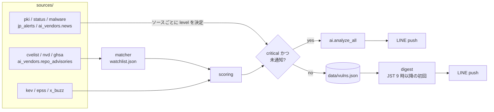

<p align="center">
  
</p>

<h1 align="center">noroshi（狼煙）</h1>

<p align="center">
脆弱性・クラウド障害・サプライチェーン攻撃などを定期収集してスコアリングし、LINE に通知する監視ボット。GitHub Actions だけで動く。
</p>

---

- 一次情報（CVE.org / NVD / GHSA / CISA KEV / EPSS ほか）を 30 分ごとに収集し、監視リスト（74 製品。組み込み部品のライブラリを含む）と照合してスコアリング
- critical は LINE に即時通知し、Claude（Opus 5.5 + web search / web fetch）がアドバイザリを読んで状況・原因の部品・影響範囲・対応策・各告知の関係を添える。同じ CVE の告知（部品の開発元、組み込み製品、注意喚起）は 1 件にまとめる
- それ以外は毎朝の日次まとめ（Claude による要点つき）。CVE 以外の事案（CA 事案、障害、悪性パッケージ、国内注意喚起、AI ベンダーの発表、EOL）も同じ経路で扱う
- 収集・スコアリングは Python 標準ライブラリのみ。状態は `data/` に JSON でコミットするのでサーバ不要

```
🚨 脆弱性アラート 1件

■ CVE-2026-109619  score 74.3
対象: php
CVSS: 9.2
PHP has various global state that temporarily points into request memory
https://github.com/php/php-src/security/advisories/GHSA-6wmf-4rv5-p3rp

🤖 CVE-2026-109619
【状況】PHP本体に解放後メモリ使用（UAF）の欠陥があり、認証なしでリモートから…
【影響範囲】PHP 8.2.35／8.3.36／8.4.27／8.5.12より前のすべての版。…
【対応策】1. 今日中に8.2.35／8.3.36／8.4.27／8.5.12以降へ更新…
【出典】https://github.com/php/php-src/security/advisories/GHSA-6wmf-4rv5-p3rp
```

## パイプライン



1 回の実行（`python -m noroshi --send`）で、収集 → 照合 → スコアリング → 通知 → 保存 → 日次まとめを行う。同一 ID（CVE ID、無ければ GHSA ID）は `Vuln.merge` で統合する。

## データソース

| カテゴリ | ソース | 取得方法 | critical（即時） | medium（日次） |
|---|---|---|---|---|
| vuln | CVE.org | `cvelistV5/cves/deltaLog.json` の先頭を Range で取得し、途中で切れた JSON は `raw_decode` で読めた所まで。新規 CVE の記録を並列取得 | スコア ≥ 70 | スコア ≥ 30 |
| vuln | NVD | CVE API 2.0、`lastModStartDate` で差分取得。`vulnerable: false` の CPE（動作環境）は除外 | 〃 | 〃 |
| vuln | GHSA | `/advisories?type=reviewed&modified=>=…` | 〃 | 〃 |
| vuln | AI 関連リポジトリ | `/repos/{r}/security-advisories`（`config/ai.json` の 15 リポジトリ、1 時間ごと） | 〃 | 〃 |
| 補強 | CISA KEV / FIRST EPSS / CISA ADP の SSVC | KEV は全件取得して突き合わせ、新規掲載は公開日が古くても候補にする | - | - |
| pki | Mozilla CA Program（Bugzilla REST） | 要約が鍵侵害・信頼取り消しなら critical、whiteboard タグが誤発行・失効遅延なら medium | 鍵侵害など | 誤発行など |
| outage | 13 社のステータスページ（`config/status.json`） | statuspage / gcp は `resolved_at` で、aws / rss / slack は一覧から消えたら復旧と判定 | major 以上（復旧も通知） | minor、初見で解決済み |
| malware | GHSA `type=malware` | npm / PyPI の週間 DL 数で人気度を判定 | ≥ 10,000 DL/週 | ≥ 1,000 DL/週 |
| jp-alert | JPCERT/CC 注意喚起、IPA（RSS 1.0） | 含まれる CVE がすべて通知済みなら medium | 未通知の事案、事前告知 | 通知済み CVE、更新 |
| ai-news | OpenAI（RSS の Security カテゴリ）、Google Security Blog（Atom）、DeepMind（RSS、キーワード）、Anthropic（sitemap の新規 URL） | タイトルや URL が incident / breach / vulnerab… に一致すれば critical | インシデント | その他のセキュリティ関連 |
| EOL | endoflife.date API v1（`config/eol.json`、48 製品） | 90・30・7 日前と当日に 1 回ずつ（`state.eol_notified`） | - | 日次まとめの末尾 |

各ソースは `fetch(fetcher, since, …) -> list[Vuln]` の形で、取得失敗はソース単位で握りつぶしてログに出す（1 ソースの障害で全体を止めない）。

## スコアリング（`scoring.py`）

```
popularity   tier1/2/3 = 30/20/10（キーワード一致は ×0.7）、監視リスト外の KEV = 10
severity     CVSS×2 + 未認証ネットワーク(AV:N & PR:N) 5 + RCE 5
             + tier1 の未認証 RCE で CVSS ≥ 9.0 なら 15
exploitation KEV 20（無ければ SSVC Exploitation=active で 15）+ ランサムウェア 5
             + exploit 参照 5 + EPSS×15
buzz         min(15, 5·log10(1 + X の言及数))   ※ X_BEARER_TOKEN 未設定なら 0

score = min(100, Σ)   critical ≥ 70 / high ≥ 50 / medium ≥ 30
```

tier1 の未認証 RCE は、KEV や SNS の反応を待たずに critical に乗るように重みを付けている。照合は `cpe`（fnmatch）→ `packages`（`ecosystem:name`）→ `kev`（vendor/product の部分一致）の順で、どれにも当たらなければ説明文の `keywords`（正規表現、前後に境界を自動付与）で照合する。

## AI（`ai.py`）

| 用途 | 呼び出し | 備考 |
|---|---|---|
| 緊急案件の分析 | `claude-opus-5-5`、effort medium、`web_search_20260209`（最大 8 回）+ `web_fetch_20260209`（最大 8 回） | 対象は vuln / pki / malware / jp-alert / ai-news（outage は除く）。`pause_turn` は会話を送り直して再開（最大 5 回）。1 通知あたり最大 4 グループ |
| 日次まとめの要点 | `claude-opus-5-5`、effort low、ツールなし | 一覧（最大 80 件）から 3 行以内 |

- 同じ CVE を指す案件（`id` と `aliases`）を `group_by_cve` でまとめ、CVE 本体を主、残りを `related_notices` として 1 回だけ分析する。LINE でも 1 つの吹き出しにする
- 部品の脆弱性は、開発元の告知・組み込み製品（Node.js、ブラウザなど）の告知・公的機関の注意喚起に分かれて出ることが多いので、プロンプトで告知どうしの関係と組み込み製品への影響を整理させている。出力は【状況】【原因の部品】【影響範囲】【対応策】【各告知の関係】【出典】
- 両方とも `fallbacks: "default"`（beta `server-side-fallback-2026-07-01`）を付け、安全分類器に断られた場合は既定の代替モデルに回す。それでも `refusal` なら分析なしで通知する
- 外部データは `<vulnerability>` / `<items>` で囲み、中身を指示として扱わないよう system prompt で明示する
- `ANTHROPIC_API_KEY` が無ければ AI 部分は丸ごとスキップ。キーの有効性は 1 日 1 回 `models.list` で確認し、`ANTHROPIC_KEY_EXPIRES` の 7 日前から LINE で警告する

## 状態とデータ（`data/`）

| ファイル | 内容 |
|---|---|
| `vulns.json` | 直近 30 日分の全候補（`Vuln` を dict 化したもの）。スコア順 |
| `state.json` | `last_run`、`notified`（ID → 通知時刻）、`open_outages`（復旧待ち）、`digest_sent` / `digest_since`、`eol_notified`、`sitemap_urls`、`repo_adv_checked`、`ai_key_checked` |

- 取得範囲は `last_run - 30 分` から（CDN キャッシュや NVD の登録遅延による取りこぼし対策）。重複は ID で統合し、`notified` で二重通知を防ぐ
- 初回（`last_run` なし）は 24 時間分。`last_run` が古くても最大 7 日分まで
- ワークフローが実行ごとに `data/` をコミットする。ローカルで編集する前に `git pull` すること

## セットアップ

1. fork する（Actions は public なら無料。private でも 30 分間隔なら月約 1,440 分で無料枠内）
2. LINE の通知先を用意する。Messaging API のチャネルは Developers Console から直接は作れないので、[LINE Official Account Manager](https://manager.line.biz/) で公式アカウントを作り、設定から Messaging API を有効にする。チャネルアクセストークン（長期）と自分のユーザー ID を控え、公式アカウントを友だち追加して応答メッセージをオフにする
3. Secrets / Variables を登録する
   ```sh
   gh secret set LINE_CHANNEL_ACCESS_TOKEN
   gh secret set LINE_TO
   gh secret set ANTHROPIC_API_KEY                          # 任意
   gh variable set ANTHROPIC_KEY_EXPIRES --body YYYY-MM-DD  # 任意
   ```
4. Actions で `collect` を有効にする。`workflow_dispatch` の `ping` を true にすると、Secrets でテスト通知を 1 通だけ送る（収集はしない）

## 開発

```sh
python3 -m noroshi --mock              # fixtures/ を使う。ネットワークに出ず、LINE にも送らない
python3 -m noroshi                     # 実データを取得して表示のみ（ドライラン）
python3 -m noroshi --send              # 実送信
python3 -m noroshi --ping              # LINE にテスト通知を 1 通
python3 -m unittest discover -s tests
```

| オプション | 内容 |
|---|---|
| `--send` | LINE に送る（既定はドライラン。`--mock` とは併用不可） |
| `--mock` | `fixtures/` のデータ（`.json` / `.xml`）を返す `Fetcher` で実行する |
| `--no-ai` | AI 分析をしない |
| `--data-dir` | 状態の保存先（既定 `data/`） |
| `--now` | 現在時刻を上書き（ISO 8601） |

- Python 3.9+ の標準ライブラリだけで動く。AI 部分の `anthropic` SDK（`requirements.txt`）は Python 3.10+ が必要で、未インストールでも AI 以外は動く。テストは SDK なしで通るように、API 呼び出しを偽クライアントで差し替えている
- ソースを足すときは `noroshi/sources/` に `fetch` を書き、`__main__.run` で `vulns` に加える。CVE 系は `collect` に渡せば照合・スコアリングされ、それ以外は `category` と `level` を自分で決める。モック用のデータを `fixtures/` に置く（中身は `[MOCK]` 付きの架空のもの）

### 環境変数

| 変数 | 用途 |
|---|---|
| `LINE_CHANNEL_ACCESS_TOKEN` / `LINE_TO` | LINE への送信（`--send` / `--ping` で必須） |
| `ANTHROPIC_API_KEY` | AI 分析と要点（任意） |
| `ANTHROPIC_KEY_EXPIRES` | キーの期限（YYYY-MM-DD、任意） |
| `NVD_API_KEY` / `GITHUB_TOKEN` | レート制限の緩和（任意。Actions では `GITHUB_TOKEN` が自動で入る） |
| `X_BEARER_TOKEN` | X の言及数（`tweets/counts/recent`、従量課金、任意） |

### 設定ファイル

| ファイル | 内容 |
|---|---|
| [`config/watchlist.json`](config/watchlist.json) | 監視製品と tier、照合用の `cpe` / `packages` / `kev` / `keywords`、全体の除外語 |
| [`config/status.json`](config/status.json) | ステータスページ（`type`: statuspage / gcp / aws / rss / slack） |
| [`config/ai.json`](config/ai.json) | アドバイザリを見るリポジトリと、AI ベンダーのフィード |
| [`config/eol.json`](config/eol.json) | EOL を予告する製品（endoflife.date の ID） |

## 費用

| 項目 | 目安 |
|---|---|
| GitHub Actions、各データソース | 0 |
| LINE Messaging API | 無料枠（月 200 通）内。想定は月 80〜100 通（push は吹き出し 5 つまで 1 通扱い） |
| Claude（緊急案件の分析） | 1 件あたり約 $0.25〜0.3 |
| Claude（日次まとめの要点） | 1 日あたり数円 |
| X API | 未設定なら 0 |

## 制限事項

- GitHub Actions の schedule は混雑時に間引かれ、実際の間隔が 1〜数時間になることがある。即時性が要るなら、外部 cron から `workflow_dispatch` を叩く。日次まとめも、JST 9 時以降の最初の実行で送られる
- 脆弱性は CVE 確定のものだけを扱う（SNS 上の未確認情報は対象外）
- Microsoft 365 は公開のステータス API が無いので対象外
- Anthropic は RSS が無いため、sitemap の新規 URL のスラッグで判定している。URL にキーワードが無い発表は拾えない
- AI 分析は出典の確認を指示しているが、誤りを含みうる。対応は出典を確認してから判断すること

## ライセンス

[MIT License](LICENSE)
